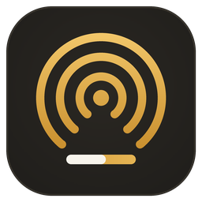

<p align="center"></p>

# Sonar

App de bandeja para Windows 10/11 (Tauri: Rust + React/TS) que controla o áudio melhor que o mixer do Windows: **cada app numa saída diferente** (ex.: Spotify na caixa, Discord e Chrome no headset), perfis com ícone e regras que o app lembra sozinho.

Estado: **v1 pronta para teste manual** no Windows 11, e o app também **roda no Windows 10** (verificado em 23/11/2026, build 19045). No Windows 10 o roteamento por app (escolher a saída ou o microfone de cada app) fica desativado; volume, mudo, perfis e atalhos funcionam. Já faz: saída e microfone por app (com regras que voltam sozinhas ao abrir o app ou reconectar o dispositivo), perfis com ícone (ex.: "Jogo"), volume e mudo por app e por dispositivo, saída padrão, medidor do microfone, apelidos de dispositivos, atalho global configurável (padrão Win+Alt+V), "Iniciar com o Windows" e painel que abre perto do ícone da bandeja. O que ainda falta testar à mão está em [`docs/VERIFICACAO.md`](docs/VERIFICACAO.md). Decisões e pendências em [`docs/DECISOES.md`](docs/DECISOES.md).

### Requisitos para compilar

- [Bun](https://bun.sh) e Rust (toolchain estável, alvo `x86_64-pc-windows-msvc`). Se `winget install Oven-sh.Bun` falhar (erro de hardlink do próprio winget), use `npm install -g bun`.
- **Visual Studio Build Tools 2022 com a carga "Desenvolvimento para desktop com C++"** (traz o MSVC e o Windows SDK). Sem eles o Rust não compila nem linka: a pasta `Lib`/`Include` do SDK tem de existir em `Windows Kits\10`. Pelo terminal: `winget install Microsoft.VisualStudio.2022.BuildTools --override "--quiet --wait --norestart --add Microsoft.VisualStudio.Workload.VCTools --includeRecommended"`.
- Windows 10/11 com WebView2 (já vem instalado no Windows 11).

## Desenvolvimento do app

```
bun install
bun run tauri dev     # abre o app na bandeja (frontend na porta 1420)
bun run test          # Vitest: telas, estado e funções puras
bun run build         # tsc + build do Vite
cd src-tauri
cargo test            # testes Rust (com fontes falsas: não toca no áudio real)
```

Testes que tocam no áudio real do PC são `#[ignore]` (rodam com `cargo test -- --ignored --nocapture`, com um app tocando som). Eles podem mudar a rota de um app: rode só com o app de teste.

Build de instalador (`bun run tauri build`): rodou de ponta a ponta no Windows 10 em 23/11/2026 (cerca de 6 minutos de compilação, gerando o `.msi` e o `-setup.exe` em `src-tauri/target/release/bundle/`). Sem a variável `TAURI_SIGNING_PRIVATE_KEY` o último passo (assinatura do updater) falha com "A public key has been found, but no private key", mas os instaladores já estão prontos; veja [`docs/RELEASE.md`](docs/RELEASE.md) para assinar.

**Se o app fechar sozinho no Windows 10:** confira a data do `sonar.exe` instalado. Versões compiladas antes de 22/11/2026 usavam a variante errada da interface de áudio e caíam com `0xc0000005` em `combase.dll` (aparece no Visualizador de Eventos). Reinstale a partir de um build novo. Pânicos do Rust ficam em `sonar-crash.log` na pasta de dados do app (`%APPDATA%\sthevandev\sonar\`); falhas nativas (access violation) não entram nesse log, só no Visualizador de Eventos.

Atualizações: o app avisa quando há versão nova (ponto na engrenagem) e instala só quando você aperta o botão em Configurações > Atualizações. Para publicar uma versão (tag `v*`, chave de assinatura e visibilidade do repositório), veja [`docs/RELEASE.md`](docs/RELEASE.md).

### Não testado nesta versão

- Roteamento por app no Windows 10: desativado abaixo da build 21390, porque a variante "Downlevel" da interface de política de áudio nunca foi validada num Windows 10 real.
- A interface de roteamento por app só foi validada no Windows 11 build 26300.
- Instalador em máquina limpa (o build foi instalado e testado neste PC, por cima de uma instalação anterior).

## Spike (descartável, em `spike/`)

```
cd spike
cargo run -- list                    # dispositivos de saída + apps com áudio
cargo run -- get <pid>               # rota gravada para o app
cargo run -- route <pid> <idx>       # manda o app para o dispositivo #idx
cargo run -- clear <pid>             # volta o app para o padrão do Windows
cargo run -- roundtrip <pid>         # lê a rota e grava de volta (diagnóstico)
```

Com `MIC=1` (variável de ambiente) todos os comandos operam em **entrada de áudio** (microfones) em vez de saída.

Usa a interface não documentada `Windows.Media.Internal.AudioPolicyConfig` (`SetPersistedDefaultAudioEndpoint`), a mesma do EarTrumpet (MIT) e do Earmark. Validado em Windows 11 build 26300 (variante "21H2" da interface). No Windows 10 o app roda, mas o roteamento por app fica desativado abaixo da build 21390 (volume e mudo continuam funcionando).

### Armadilha que custou horas

O ID do dispositivo enviado ao Windows precisa ser **exatamente**
`\\?\SWD#MMDEVAPI#{0.0.0.00000000}.{GUID}#{e6327cad-dcec-4949-ae8a-991e976a79d2}`
(duas barras no início). Com uma barra a menos o Windows responde `E_INVALIDARG` (0x80070057) sem dar pista. Diagnóstico que resolveu: `get` devolve o texto que o Windows guardou; comparar o tamanho (111 caracteres) com o que o código monta.

## Ícone

Fonte vetorial em `assets/icon/sonar.svg` (app) e `sonar-tray.svg` (bandeja). Os PNGs e o `.ico` são gerados por `python tools/make_icons.py` (Pillow). Paleta: grafite `#1B1A18`, latão `#D9A441`, branco `#F7F4EC`. A bandeja tem versão clara (`tray/`) e escura (`tray-light/`, para a barra de tarefas do tema claro).

## Referências

- EarTrumpet: https://github.com/File-New-Project/EarTrumpet (`EarTrumpet/Interop/MMDeviceAPI/`, `AudioPolicyConfigService.cs`)
- Earmark: https://github.com/hoobio/earmark (`src/Earmark.Audio/Interop/`)
