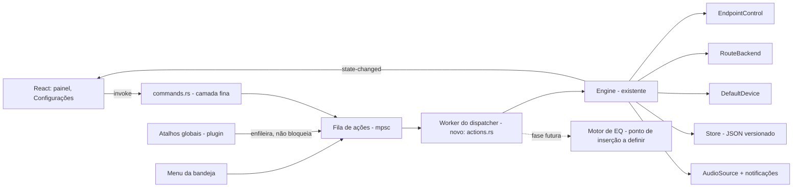

# Sonar: estudo e system design (ações globais e equalizador)

Data: 2026-11-04. Tipo: estudo de arquitetura. **Nada foi implementado, nenhum arquivo do repo foi alterado, nenhum teste de áudio foi executado.**

Legenda de marcação: **[código]** = verificado no repo (`arquivo:linha`); **[doc]** = documentação oficial ou de fornecedor lida (ou trecho de busca, quando indicado); **[hipótese]** = inferência não verificada; **PENDENTE** = depende de experimento.

---

## 1. Escopo e fontes

- **Commit examinado:** `2d35fe2078f6da3a586bf026117b3d16a8e17c46`, branch `main` (último merge: PR #3, `fix/versao-0.1.1`). Clone raso em `D:\Projetos\sonar`. [código]
- **Branch** `feat/sonar-v1` **não encontrado no remoto.** A nota do vault (`1-Projetos/audio-control.md`, 2026-11-03) menciona esse branch com backend e telas. O `fetch` falhou e o ref não resolve. Se o trabalho mais novo estiver em outro lugar, esta análise não o cobre. [código]
- **Análise anterior (**`sonar-analise-repositorio.md`**):** não encontrada. Busca por nome e conteúdo no vault não retornou nada; a busca por glob em `D:\Projetos` estourou o tempo, então a ausência não é exaustiva. Não foi usada.
- **Notas do vault:** a nota `audio-control.md` diz "Fora: equalizador/efeitos", o que bate com o código. A mesma nota diz que o updater não estava mergeado; **isso está desatualizado**: `src-tauri/src/updates.rs` existe e é ligado em `lib.rs:15, 65-66, 86-88`. [código]
- **Lido no código:** `lib.rs`, `engine.rs` (produção completa, até `build_state`; testes só parcialmente), `commands.rs`, `state.rs`, `shell.rs:1-140` e assinaturas do restante, `audio/policy.rs:1-135`, `audio/endpoint.rs` (trait e impl), `audio/devices.rs` e `audio/default_device.rs` (assinaturas e cabeçalhos), `store.rs`, `profiles.rs`, `rules.rs` (assinaturas), `Cargo.toml`, `tauri.conf.json`, `capabilities/default.json`, `src/api.ts`, `docs/DECISOES.md`.
- **Lido parcialmente ou não lido:** `docs/superpowers/specs/2026-11-02-audio-control-design.md` e `docs/superpowers/plans/2026-11-03-sonar-v1.md` (só listados e citados por trechos de busca), `spike/`, toda a UI React além de `api.ts`.
- **Documentação consultada:**
  - Microsoft Learn: arquitetura de APO (`audio-processing-object-architecture`), implementação de APO (`implementing-audio-processing-objects`), `AUDIOCLIENT_PROCESS_LOOPBACK_PARAMS`, `ActivateAudioInterfaceAsync` (trecho de busca).
  - Tauri v2: plugin global-shortcut (trecho de busca).
  - Equalizer APO: página oficial no SourceForge.
  - VB-Audio: página de produto (trecho de busca).
  - OSR Community: anedotas sobre assinatura de APO (não tratadas como fonte normativa).
- **Não verificado nesta sessão:** wiki de instalação do Equalizer APO (admin, dispositivos); exigências atuais de assinatura de driver (EV, attestation, WHQL) para APO; comportamento de process loopback no Windows 10; WASAPI loopback (doc não lida); latência de qualquer caminho (nada foi medido).

---

## 2. Diagnóstico do código existente

### 2.1 Stack e camadas [código]

- Tauri 2 (Rust no backend, React/TypeScript na UI). `src-tauri/Cargo.toml:16-27`.
- COM/Win32 pelo crate `windows` 0.62, com as features de áudio, WinRT e shell. `Cargo.toml:33-52`.
- Uma janela `panel` (420x700, sem decoração, oculta no início). `tauri.conf.json:13-26`.
- Persistência em JSON versionado (`{"version": N, "data": ...}`). `store.rs:3`.

### 2.2 Como o áudio é controlado hoje

| Função | Mecanismo | Onde | Natureza |
|---|---|---|---|
| Enumerar endpoints | `IMMDeviceEnumerator` | `devices.rs:62-66`, `121` | Documentada |
| Notificações de dispositivo | `IMMNotificationClient` | `devices.rs:195-210`, `241` | Documentada |
| Sessões por app | `IAudioSessionNotification` / sessões | `sessions.rs:138` (`register_session_notifier`) | Documentada |
| Volume e mudo do endpoint | `IAudioEndpointVolume` | `endpoint.rs:34-41`, `126-160` | Documentada |
| Volume e mudo por sessão | `ISimpleAudioVolume` | `endpoint.rs:65-68`, `172-186` | Documentada |
| Pico do medidor | leitura de pico do endpoint | `endpoint.rs:160-170` | Documentada (confirmar interface) |
| Trocar saída/entrada padrão | `IPolicyConfig` declarada à mão | `default_device.rs:3`, `35-38`, `117-118` | **Não documentada** |
| Rotear app para dispositivo | `AudioPolicyConfig` declarada à mão, IID e índice de vtable por variante | `policy.rs:28-37`, `77-96`, `232-240` | **Não documentada** |

Pontos de atenção:

- O roteamento depende de **IIDs e índices de vtable** fixos por variante de build (`policy.rs:35-37`, `77-82`, `92-96`). `variant_for_build` cobre Win11 a partir de 21390 e Downlevel a partir de 19041 (`policy.rs:28-31`, `66-74`). Isso é frágil por natureza: quebra silenciosa ou falha em builds novas. O próprio `DECISOES.md:44-47` reconhece que a interface foi "declarada na mão". [código]
- O único teste de roteamento real é `#[ignore]` e exige variáveis de ambiente e um app tocando áudio (`policy.rs:325-327`). Persistência da rota (sobreviver a reinício) está em aberto. [código, DECISOES.md:52]

### 2.3 Estado, regras e perfis

- `Engine` guarda tudo em `Inner` (`engine.rs:44-62`) e serializa operações com quatro travamentos, sempre nessa ordem: `apply` > `persist` > `emit` > `inner` (`engine.rs:4-9`). [código]
- Contador `generation` impede que uma leitura do sistema que começou antes de uma mudança do usuário sobrescreva essa mudança (`engine.rs:59-61`, `406-419`). Esta é a garantia mais importante a preservar. [código]
- Regras: `Rule { exe, flow, device }` (`rules.rs:10`), um conjunto com `upsert`/`remove` (`rules.rs:34-51`), aplicadas por `reconcile`/`reconcile_rule` (`rules.rs:61`, `76`).
- Perfis: `Profile { id, icon, name?, items }`, cada item com `output` e `input` do tipo `Target` = `Device(id) | Default | Keep` (`profiles.rs:15-26`, `53-70`). `activate` (`profiles.rs:102-124`): `Default` gera `Change::Cleared` (`118-120`). [código]
- Ativação de perfil é **só manual**, pela UI, via `activate_profile` (`commands.rs:121-128`, `engine.rs:198-241`). Não há atalho nem ciclo de perfis. [código]
- `last_profile` existe só em memória (`engine.rs:53`, `state.rs:77`). [código]

### 2.4 Atalho global

- Um atalho só, de `Settings.shortcut` (padrão `"Super+Alt+V"`, `state.rs:13, 20`). [código]
- O handler do plugin faz uma única coisa: `shell::toggle_from_shortcut` (`lib.rs:53-61`, `shell.rs:192`). Não existe registro de ações. [código]
- Registro e troca do atalho: `shell.rs:252` (trait), `279` (impl), `338` (`apply_at_startup`), `350` (`apply_settings`, que valida antes de gravar; `commands.rs:167-172`). [código]
- Permissão do plugin: `global-shortcut:default` em `capabilities/default.json:6`. [código]

### 2.5 IPC e eventos

- 22 comandos registrados em `lib.rs:69-89`. Camada fina em `commands.rs:43-172`. Erros viram `String` em português (`commands.rs:28-41`). [código]
- Eventos: `state-changed` com snapshot completo (`commands.rs:15`, `engine.rs:471-475`) e `mic-level` a ~15 Hz com o painel aberto (`commands.rs:17`, `lib.rs:38-40`, `174-193`). [código]
- A interface chama comandos específicos por ação (`set_app_route`, `set_device_volume`, `set_default_device` etc.). As ações **não são um conceito** no backend. [código, `src/api.ts`]
- `set_device_volume`, `set_device_muted` e `set_default_device` aceitam qualquer `DeviceId`, sem checar o fluxo (`engine.rs:329-357`, `commands.rs:78-96`). Portanto mudo de microfone já é chamável pelo IPC; se o Windows aceita `IAudioEndpointVolume` em captura, é **PENDENTE** (DECISOES.md:39 diz "não testada").
- `set_session_volume` e `set_session_muted` trabalham **por pid** (`engine.rs:315-326`, `commands.rs:53-75`). Mudo "por app" exige expandir exe para pids. [código]

### 2.6 Segurança e configuração

- CSP restrita (`tauri.conf.json:28-30`). [código]
- Capabilities: só a janela `panel` (`default.json:5`). [código]
- Comandos próprios do app não aparecem em permissões. Em Tauri v2 é preciso confirmar se isso dispensa permissão explícita. **PENDENTE** (ver §6).
- Updater com endpoint no GitHub e chave pública (`tauri.conf.json:44-53`). [código]
- `tauri-plugin-single-instance` ignora os argumentos da segunda execução (`lib.rs:46-48`). Hoje não há entrada por linha de comando. [código]

### 2.7 Lacunas reais para os objetivos

- **L1. Não há camada de ações.** Ações existem só como comandos IPC específicos. Não há como disparar "mutar saída padrão" por atalho ou bandeja sem duplicar lógica. [código]
- **L2. Não há ação de perfil por atalho nem ciclo de perfis.** `last_profile` não é persistido. [código]
- **L3. Não há alvo "padrão" resolvido na execução.** Já existe `default_capture()` (`engine.rs:366-372`), mas não um equivalente para render nem uma resolução centralizada. [código]
- **L4. Não há mudo de app por exe.** Só por pid (`engine.rs:322`). [código]
- **L5. Atalhos: um único binding**, sem lista, sem detecção de conflito além do erro de registro, e sem migração pensada para múltiplos bindings. [código]
- **L6. Equalizador: zero código.** Não há tipo de filtro, modelo de banda, persistência de EQ, nem ponto de inserção no áudio. Também não há processamento de sinal (`grep` por `equaliz|APO|effect|biquad` só encontra textos de documentação). [código]
- **L7. Win10:** o `DOWNLEVEL_MIN_BUILD` (19041, `policy.rs:31`) é o limiar do roteamento. A doc da Microsoft para `AUDIOCLIENT_PROCESS_LOOPBACK_PARAMS` diz Windows 10 build 20348 como mínimo [doc]. Se process loopback for usado algum dia, Win10 fica de fora ou precisa de caminho próprio. **PENDENTE.**
- **L8. Pontos bons para reaproveitar:** `EndpointControl` e `RouteBackend` são traits com fakes em teste (`engine.rs:606-...`); o motor é testável sem áudio real. [código]

---

## 3. Objetivos e não objetivos

**Objetivos**

- O1. Camada única de **ações globais** (`Action` + dispatcher), usada por UI, bandeja, atalhos e futuras entradas.
- O2. Ativar perfil por atalho e ciclar perfis.
- O3. Mutar/desmutar e ajustar volume da saída padrão e do microfone padrão; mutar app por exe.
- O4. Definir o caminho do equalizador, com decisão registrada (ver §8 e §9).
- O5. Preservar o contrato atual: snapshot `AppState`, eventos e a garantia de `generation`.

**Não objetivos**

- Comando de voz. Não é requisito.
- Detecção automática de jogo ou de perfil (DECISOES.md:16 mantém ativação manual).
- Implementar EQ neste estudo, ou construir APO/driver próprio na próxima versão.
- Outros efeitos (normalização, reverb) (`spec` linha 27 deixa de fora).
- Volume de microfone por app (não suportado, DECISOES.md:39).
- Trocar de framework.

---

## 4. Catálogo de ações globais

Convenções: "padrão" é resolvido **no momento da execução**, dentro do travamento `apply`. Toda ação devolve `{ ok, changed, resolved, error_code }`. Prefere-se `set` explícito a `toggle`, porque `set` é idempotente.

| # | Ação | Alvo | Semântica | Estados / pré-condições | Idempotência | Erro esperado | Status |
|---|---|---|---|---|---|---|---|
| A1 | Mostrar/ocultar painel | painel | `toggle` existente; propor também `show`/`hide` | janela existe | `toggle` não é; `show`/`hide` são | — | Existe (`shell.rs:192`) |
| A2 | Ativar perfil `<id>` | global | aplica `profiles::activate` (regras e saída por app) | perfil existe | Sim, em efeito: reaplica as mesmas regras | "Perfil não encontrado." (`commands.rs:126`); roteamento indisponível (`routing_available`) | Existe por IPC; falta atalho |
| A3 | Próximo/anterior perfil | global | avança na lista salva de perfis | lista não vazia; `last_profile` (hoje só em memória) | **Não** (cada chamada avança) | sem perfis: no-op com aviso; perfil apagado: volta ao primeiro | Não existe |
| A4 | Mudo da saída padrão `set(true\|false)` | saída padrão (render) | define o mudo | há padrão conectado | Sim (com `set`). `toggle` depende de leitura fresca | "dispositivo não está mais disponível" (`Gone`, `commands.rs:31`) | Parcial (IPC por id, `engine.rs:341`) |
| A5 | Mudo do microfone padrão `set(true\|false)` | captura padrão | igual A4 para captura | há microfone conectado | Sim | igual A4 | **PENDENTE**: validar `IAudioEndpointVolume` em captura |
| A6 | Volume da saída padrão `delta` (ex.: ±5%) | saída padrão | relativo; clamp 0..1 (`endpoint.rs:24`) | padrão conectado | **Não**. Rajadas devem ser coalescidas | igual A4 | Parcial |
| A7 | Volume absoluto da saída padrão `value` | saída padrão | define o volume | igual A4 | Sim | igual A4 | Parcial |
| A8 | Mudo de app `<exe>` `set(true\|false)` | sessões do exe no fluxo render | define o mudo de todos os pids do exe | exe com sessão ativa | Sim | "app não está tocando": **resultado vazio, não erro fatal** | Parcial (por pid, `engine.rs:322`) |
| A9 | Mover app `<exe>` para saída `X` ou `Padrão` | regra do exe | = `set_app_route` | dispositivo pode estar ausente (regra guardada, `engine.rs:1341`) | Sim | "Este Windows não permite essa operação." se `Unsupported` | Existe (`engine.rs:140`) |
| A10 | Próxima saída padrão (ciclo) | saídas conectadas e visíveis | troca o padrão para a próxima da lista | há 2 ou mais saídas | **Não** | nenhuma outra saída: no-op | Não existe |
| A11 | Mudo geral (saída padrão + apps) | global | `set` em tudo | — | Sim com `set` | parcial: alguns apps falharem não cancela os demais | Proposta; decisão em §11 (D4) |
| A12 | Reaplicar regras | interno | `refresh` | — | Sim | — | Existe, não exposto (`engine.rs:126`) |

Observações:

- A2 e A3 usam o `Engine::activate_profile` existente. A3 precisa de persistência de `last_profile` se o ciclo tiver que sobreviver a reinício. Hoje ele não sobrevive. [código]
- A4 e A5 precisam de um **helper de resolução**: `default_render()` e `default_capture()` (este já existe em `engine.rs:366`). [código]
- Erros de `AudioError::Os(code)` viram mensagem com código hexadecimal (`commands.rs:32`). No atalho, a mensagem deve ir para o `save_error`-like de ação ou para evento próprio, não para pop-up da janela (que pode estar oculta).

---

## 5. Arquitetura incremental (preserva Tauri, Rust e React)



Passos incrementais, cada um testável sozinho:

1. **Extrair** `Action` **e o resolvedor de alvos** para `actions.rs`, sem alterar comportamento. Os comandos IPC atuais continuam chamando o `Engine`. Testes com os fakes já existentes.
2. **Adicionar o dispatcher** (fila + worker) e migrar a bandeja e o atalho para ele. O handler do atalho apenas enfileira, para nunca bloquear o thread do plugin. [hipótese: o plugin chama o handler em thread própria; confirmar]
3. **Bindings de atalho** em `Settings` (§7), com migração de `shortcut` legado.
4. **Ações de microfone** (depois de S1).
5. **Ponto de inserção do EQ** (só após decisão em §9).

Fluxos principais:

- **Atalho de mudo:** tecla → plugin → fila → worker → `apply` → `resolve(default_render)` → `ctl.set_muted` → `refresh` → `emit` → UI.
- **Slider da UI:** mantém o comando atual `set_device_volume` (sem mudança de contrato).
- **Perfil por atalho:** tecla → fila → `activate_profile` (já existente).

Regra de ouro: o dispatcher **não segura travamento próprio durante chamada COM**. Ele só serializa a ordem de chegada, e quem decide ordem de escrita continua sendo o `Engine` (`apply`).

---

## 6. Dispatcher central

**Resolução de alvos.** Enum `Target` de ação: `DefaultOutput`, `DefaultInput`, `Device(id)`, `App(exe)`, `Profile(id)`, `Global`. Resolver em um único lugar, sob `apply`, com o snapshot do momento. Registrar no resultado o `resolved` (ex.: id do dispositivo efetivamente afetado).

**Concorrência.**

- Fila única (`mpsc`) com worker. Os produtores (atalho, bandeja, IPC) nunca esperam a execução.
- Coalescer ações relativas (A6) por alvo, com janela curta (proposta: ~50 a 100 ms). Ações absolutas (A4, A7, A8) não precisam de coalescência; a última vence.
- O `Engine` já serializa com `apply` (`engine.rs:79-80`). Não criar um segundo lock de dados.

**Idempotência.** Preferir `set`. Para `toggle` (se existir), ler sob `apply` e registrar `changed: bool`. Não gravar em disco quando `changed == false`.

**Atalhos e conflitos.**

- Validar sintaxe antes de gravar; rejeitar binding duplicado dentro do próprio app.
- Registro falhando (ex.: tecla usada por outro app ou reservada pelo sistema): o binding fica "indisponível", com mensagem, e os demais continuam. **Hipótese:** o plugin devolve erro nesse caso (o código já trata `register` como `Result`, `shell.rs:252`). Confirmar.
- Ao trocar o atalho, **desregistrar o antigo antes de registrar o novo**. Fonte secundária (dev.to) recomenda isso; confirmar na doc oficial.
- Teclas reservadas pelo Windows (ex.: Win+L) são **hipótese** de falha de registro; testar no Win11 26300.

**Segurança.**

- Ações só entram como enum tipado (`serde` com tag). Tipo desconhecido é rejeitado com erro, não ignorado.
- Validar exe com `apps::parse_exe_request` (já existe, `apps.rs:76`, e rejeita UNC, verbatim e caminho relativo, segundo o próprio teste).
- Device id precisa existir no snapshot. Volume é clamp (`endpoint.rs:24`). Limitar tamanho de strings de nome e de accelerator.
- Capabilities: manter a janela `panel` como única. Se algum dia houver segunda janela ou deep link, definir capabilities por janela. **Resolvido em 2026-11-06 (Task 8):** comandos próprios do `invoke_handler` **não** precisam de permissão explícita. `src-tauri/build.rs` é só `tauri_build::build()` — sem `AppManifest::commands` — e o manifesto gerado (`src-tauri/gen/schemas/acl-manifests.json`) traz **apenas** as permissões de plugin (`core`, `dialog`, `global-shortcut`, `updater`), nenhuma do app. Os ~21 comandos que o app já expõe (`get_state`, `save_settings`, … e o novo `dispatch_action`) rodam sem nenhuma entrada em `capabilities/default.json`; o que a capability restringe é o **comando de plugin** e o **acesso do lado do JS** (`core:default` já traz `core:event:default`, que cobre o `listen("action-result")` do painel). **Consequência para a superfície de ataque:** a permissão não é a barreira do comando próprio — a barreira é a janela (`windows: ["panel"]`) e o fato de o comando rodar dentro do processo do app. Um `invoke("dispatch_action")` feito por qualquer página carregada na janela `panel` executa com os privilégios do app.
- Entrada por linha de comando (`sonar.exe --action ...`) fica como opção, não como requisito. Hoje `single-instance` ignora os args (`lib.rs:46-48`).

---

## 7. Modelos de dados, contratos e migração

### 7.1 Perfil (atual) [código]

`{ id, icon, name?, items: [{ exe, output: "default"|"keep"|<device id>, input: ... }] }` (`profiles.rs:15-70`). Sem mudança obrigatória para as ações de perfil.

### 7.2 Settings (proposta, aditiva)

Hoje: `{ shortcut: "Super+Alt+V", autostart: false }` (`state.rs:9-24`), com `#[serde(default)]` (`state.rs:11`).

Proposta: acrescentar `bindings`, mantendo `shortcut` para leitura legada:

```json
{
  "shortcut": "Super+Alt+V",
  "autostart": false,
  "bindings": [
    { "accelerator": "Ctrl+Alt+M", "action": { "type": "set_output_mute", "muted": true } },
    { "accelerator": "Ctrl+Alt+Up", "action": { "type": "step_output_volume", "delta": 0.05 } },
    { "accelerator": "Ctrl+Alt+P", "action": { "type": "cycle_profile", "direction": "next" } }
  ]
}
```

Exemplos de ações (design, não implementação): `{"type":"activate_profile","profile_id":"p1"}`, `{"type":"set_output_mute","muted":true}`, `{"type":"step_output_volume","delta":0.05}`, `{"type":"set_app_mute","exe":"discord.exe","muted":true}`, `{"type":"move_app","exe":"chrome.exe","device":"<id>|null"}`.

**Migração:** `shortcut` legado vira `bindings: [{ accelerator: shortcut, action: { type: "toggle_panel" } }]` na primeira leitura. Como `Store` já grava `.bak` antes de sobrescrever (`store.rs:49-68`), a migração pode ser reversível.

### 7.3 Versão do Store

- `CURRENT_VERSION = 1` (`store.rs:12`). Para mudanças aditivas com `serde(default)`, não é preciso migração. Para renomear `shortcut` → `bindings`, é preciso um passo de migração em `Store::load` ou em `Settings::from_legacy`, condicionado à versão. [código + proposta]

### 7.4 Contratos IPC (exemplificativos)

- `dispatch_action(action) -> { ok, changed, resolved, error_code }`
- Evento opcional `action-result` (ou reutilizar `state-changed`).
- Manter `set_*` existentes para a UI, sem quebra.

### 7.5 Modelo de EQ (proposta de design, não implementar)

Documento separado `eq.json`, com versão própria, indexado por id do endpoint:

```json
{
  "version": 1,
  "devices": {
    "<endpoint id>": {
      "bypass": false,
      "preamp_db": -3.0,
      "bands": [
        { "type": "peaking", "freq_hz": 1000, "gain_db": -2.5, "q": 1.0, "enabled": true },
        { "type": "highshelf", "freq_hz": 8000, "gain_db": 1.5, "q": 0.7, "enabled": true }
      ]
    }
  }
}
```

Tipos de filtro sugeridos: `peaking`, `lowshelf`, `highshelf`, `highpass`, `lowpass`, `notch`.
Limites **propostos** (sem fonte nesta sessão): frequência 20 Hz até metade da taxa de amostragem; ganho de -24 a +12 dB; Q de 0,1 a 10; até 31 bandas; preamp para evitar clipagem.
Um perfil poderia referenciar `eq_preset_id` no futuro. Não implementar agora.

---

## 8. Alternativas de EQ

Legenda: "não medido" = nenhum valor de latência foi medido.

| Critério | (a) Integração opcional com Equalizer APO | (b) APO próprio ou driver próprio | (c) DSP em user mode com roteamento virtual |
|---|---|---|---|
| Escopo | Por **dispositivo** (APO no endpoint) [doc: "system-wide"; instalador escolhe o dispositivo, fonte de busca] | Por dispositivo (APO é por endpoint/modo) | Por dispositivo (c1) ou por app (c2) |
| Dependências | Equalizer APO instalado pelo usuário [doc] | C++/COM, APO em DLL, INF, pacote de driver [doc] | Driver virtual (VB-CABLE ou próprio) para ter ponto de inserção [hipótese] |
| Admin | Instalação: **provável** [hipótese]; configurar Sonar: a verificar | Sim, instalação de driver [doc] | Instalar driver virtual: sim [hipótese] |
| Assinatura | Responsabilidade do Equalizer APO [doc parcial] | APO sem assinatura adequada **falha ao carregar** quando a proteção de áudio está ativa [doc: "APO is not properly signed"]; exigência exata (EV, attestation, WHQL) **PENDENTE** | Driver virtual de terceiro: já assinado pelo fornecedor [hipótese]; próprio: mesma exigência de (b) |
| Licença | Equalizer APO é **GPLv2** [doc]. Empacotar código GPL em produto fechado é questão jurídica a consultar; integrar por arquivo de configuração **parece** diferente, mas é a decidir | Própria | VB-CABLE é **donationware**; distribuição empacotada exige acordo com o fornecedor [doc: "contact VB..."]. Driver próprio: sem licença de terceiro |
| Latência | Não medido. Processamento dentro do pipeline do Windows, sem cópia extra [hipótese] | Não medido. Regras de tempo real: sem bloqueio, memória não paginável [doc] | Não medido. Soma de buffers do WASAPI e do driver virtual [hipótese] |
| Formatos | APO trabalha em float32 como requisito de APO [doc]. Formatos do Equalizer APO: não verificado | float32 é o formato padrão de APO [doc] | Mix format do modo compartilhado; reamostragem [hipótese] |
| Bypass | Por configuração [hipótese] | Próprio (ex.: flag no APO) | Passthrough trivial [hipótese] |
| Hotplug | APO fica preso ao endpoint; dispositivo novo precisa ser configurado [doc parcial]. Sonar deve detectar | APO é PnP-filho do dispositivo; registrado por driver, **não é global** [doc] | `IMMNotificationClient` já existe (`devices.rs:195`); reabrir streams [hipótese] |
| Modos de falha | Após 10 falhas de APO, o SysFX é desativado (`PKEY_Endpoint_Disable_SysFx`) [doc]. Sonar precisa explicar isso | Igual, mais falha de carga por assinatura [doc] | Stream invalidado ao trocar dispositivo [hipótese]; áudio duplicado se o roteamento for desfeito |
| Limite por app | **Não**: ASIO e WASAPI exclusivo não passam pelo caminho [doc] | Não nativo. Efeito por modo ou stream; identificar o app não é garantido [hipótese] | Sim em c2, com complexidade: rotear o app para o virtual (policy existente) e capturar |
| Esforço | Baixo a médio | Alto | Médio a alto |
| Risco para o produto | Baixo; depende de terceiro | Alto (assinatura, driver, suporte) | Médio (driver de terceiro, latência não medida) |

**Ponto-chave [hipótese, a validar em S5]:** sem APO ou driver virtual não há ponto de inserção no caminho de saída. `AUDIOCLIENT_PROCESS_LOOPBACK` captura o áudio de um processo, mas o áudio original continua saindo pelo dispositivo original. Por isso o EQ por app exige rotear o app para um dispositivo virtual, e o Sonar já sabe fazer isso (`policy.rs`). Essa é a parte que mais precisa de experimento.

**Sobre o próprio APO vs o Equalizer APO.** Equalizer APO é um exemplo de APO para o caso de uso de EQ por dispositivo. Fazer APO próprio só se justifica se o produto precisar de controle que o Equalizer APO não dá, e isso não está demonstrado.

---

## 9. Recomendação

**Comandos (MVP): seguir sem EQ.** Implementar o dispatcher (§5 e §6) e as ações A2, A3, A4, A6, A7 e A8. Não exige driver, não exige admin, e pode ser testado com os fakes existentes (`engine.rs:606-...`) e manualmente no Win11 26300.

**Equalizador: decidir antes de codar.** Recomendação (proposta):

1. Caminho de menor risco: **(a) integração opcional com Equalizer APO**, por dispositivo, com spike S3 (detectar, configurar, bypass e comportamento em hotplug).
2. **Não** construir APO próprio na próxima versão (b).
3. EQ **por app** só depois de medir latência e custo do caminho (c2) com dispositivo virtual (S5), e de decidir a licença (D2/D3).

Alternativas com tradeoffs:

- Se o EQ precisa ser por app desde o início, o caminho é (c2), com dependência de driver virtual de terceiro e latência não medida.
- Se o produto for fechado e não quiser depender de GPL nem de terceiros, sobra (c) com driver próprio, que é o caminho de maior custo.

---

## 10. Fases de entrega e spikes

### Fases (cada uma com aceite e teste manual no Win11 26300)

- **F0. Refatoração sem mudança de comportamento.** Criar `actions.rs` e o resolvedor de alvos (§5, passo 1).
  - Aceite: todos os testes atuais passam; nenhuma mudança na UI; `state.rs` e `store.rs` sem alteração de formato.
  - Manual: trocar saída de um app, mutar, mudar volume, trocar perfil pela UI. Nada muda.
- **F1. Dispatcher e atalhos de ação básica.** Fila + worker; bandeja e atalho migrados; ações A2, A4, A6, A7, A8.
  - Aceite: teste unitário de idempotência (`set` duas vezes = uma mudança); teste de coalescência de A6; atalho não bloqueia.
  - Manual: atalho muta a saída padrão e desmuta; volume sobe e desce em passo; atalho ativa perfil; dispositivo desconectado não derruba o app.
- **F2. Bindings e migração.** Lista de bindings, validação, registro por binding, migração de `shortcut`.
  - Aceite: migração de arquivo antigo (com `.bak`); conflito dentro do app recusado; binding de tecla ocupada por outro app mostrado como indisponível.
  - Manual: trocar atalho com o painel aberto e fechado; reiniciar e confirmar que o atalho persiste.
- **F3. Ciclo de perfil e próxima saída (A3, A10).** Requer decidir persistência de `last_profile` (§11 D4).
  - Aceite: ciclo volta ao primeiro após o último; perfil apagado não quebra o ciclo.
  - Manual: ciclar com três perfis; apagar o perfil atual pela UI e ciclar de novo.
- **F4. Microfone (A5), depois de S1.Q**
  - Manual: mutar o microfone padrão pelo atalho e confirmar no Windows (ícone de mudo).
- **F5. EQ, somente após decisão em §11 e spikes S3 e S5.** Não entra nesta fila.

### Spikes (PENDENTE até rodar)

- **S1. Volume e mudo do endpoint de captura.** Verificar `IAudioEndpointVolume` em microfone real. Hoje só há um microfone no PC de casa (DECISOES.md:39). **PENDENTE.**
- **S2. Roteamento após reinício e fechamento do app.** Já listado como aberto (DECISOES.md:52). **PENDENTE.**
- **S3. EQ via Equalizer APO.** Instalar em máquina de teste, aplicar configuração a um endpoint, testar bypass, troca de dispositivo, desconexão e reconexão, e observar os 10 erros do SysFX. Medir o que for medido. **PENDENTE.**
- **S4. Conflitos de atalho.** Registrar teclas já usadas e reservadas; ver o erro devolvido pelo plugin. **PENDENTE** — a sonda (código) está pronta; a tabela de resultados depende de execução real no Win11 e está **PENDENTE DO AUTOR** (Task 9, Step 4).
  - **Como rodar a sonda.** Só existe em build de depuração (`cargo test`/`bun run tauri dev`); em release a sonda não é compilada e a variável não é lida. Com o app fechado, abrir em modo de desenvolvimento com a variável `SONAR_PROBE_SHORTCUTS` contendo os aceleradores separados por vírgula:

    ```powershell
    $env:SONAR_PROBE_SHORTCUTS="Ctrl+Alt+M,Ctrl+Alt+Up,Ctrl+Alt+Down,Ctrl+Alt+P,Ctrl+Alt+1,Win+D"
    bun run tauri dev
    ```

    Na abertura, o app registra e solta cada combinação, uma por vez e na ordem, e imprime o resultado de cada uma em `stderr`:

    ```
    sonar: sonda de atalhos (6 combinações)
    sonar: sonda OK Ctrl+Alt+M
    sonar: sonda FALHOU Ctrl+Alt+Up: Não foi possível registrar o atalho Ctrl+Alt+Up. Outro programa pode estar usando essa combinação.
    ```

  - **Combinações a cobrir:** os padrões propostos no §11.1 (`Ctrl+Alt+M`, `Ctrl+Alt+Up`, `Ctrl+Alt+Down`, `Ctrl+Alt+P`, `Ctrl+Alt+1`) e pelo menos uma tecla reservada do sistema (`Win+D`) para ver se combo reservado falha no registro. **Nunca** `Win+L`: trava a tela, e o risco não compensa o que se aprende.
  - **Resultado (tabela) — PENDENTE DO AUTOR.** Rodar no Win11 26300 e registrar aqui quais combinações passaram e quais falharam; se um padrão falhar, trocá-lo em `default_bindings()` (a ser criado na fase F2).
- **S5. Caminho de EQ por app com dispositivo virtual.** Rotear um app para VB-CABLE usando o `policy.rs` atual, capturar com loopback e reproduzir no físico. Medir latência e contar falhas em troca de dispositivo. Não medido até fazer. **PENDENTE.**
- **S6. Win10.** Confirmar se process loopback e a variante Downlevel funcionam em Windows 10 (o teste de build 20348 da doc). Hoje Win10 está "não testado" (DECISOES.md:19). **PENDENTE.**

---

## 11. Decisões que o Sthevan precisa tomar

Os defaults são **proposta**; nenhum foi decidido.

- **D1. EQ por dispositivo ou por app?**
  - Proposta: **por dispositivo** (caminho (a) ou (b)). Por app exige (c2) e dispositivo virtual.
- **D2. Aceita depender de software de terceiro para o EQ?** Equalizer APO (GPLv2) e VB-CABLE (donationware).
  - Proposta: sim, como **integração opcional**, sem empacotar o código de terceiro.
- **D3. Produto fechado ou open source?** Muda o que é possível empacotar (GPL) e o que dá para usar de terceiros.
  - Proposta: decidir antes de F5. Não bloqueia F0 a F4.
- **D4. Persistência de ciclo de perfil.** `last_profile` some ao fechar o app.
  - Proposta: **não persistir** na primeira versão; o ciclo começa do primeiro perfil.
- **D5. Lista de ações e mudo geral (A11).** Lista fechada ou livre?
  - Proposta: **lista fechada** com A2, A3, A4, A6, A7, A8, A9 e A10. A11 (mudo geral) fica fora até haver um desfazer claro.
- **D6. Win10 e o EQ.** Win10 fica com volume e roteamento (já implementados, não testados), e o EQ só no Win11 até S6.
  - Proposta: essa divisão.

### 11.1 Adendo de 2026-11-04 (decisões do autor)

- **Uso pessoal.** O app é para uso do próprio autor. D3 (open source ou fechado) deixa de ser bloqueante e a licença passa a ser irrelevante para a v1.
- **EQ na próxima versão.** O equalizador não entra na versão atual; é o foco da versão seguinte. Os spikes S3 a S6 continuam valendo como base técnica, mas sem prazo nesta fase.
- **Atalhos globais.** Funcionam com qualquer app em foco e independem da rede e de o app de destino estar aberto; dependem só de o Sonar estar em execução.
  - Padrões propostos (todos reconfiguráveis nas Configurações, sem tecla fixa):
    - Ativar perfil 1 / 2 / … : `Ctrl+Alt+1`, `Ctrl+Alt+2` (ação A2).
    - Mudo da saída padrão (toggle): `Ctrl+Alt+M` (ação A4). **Não usar** `Ctrl+M`**:** é atalho de muitos apps (ex.: Gmail, Teams) e um registro global o sobrescreveria em todos eles. [hipótese, a confirmar no S4]
    - Ciclar perfil: `Ctrl+Alt+P` (ação A3), consistente com a tabela do §8.
  - Antes de registrar um atalho, o app deve checar conflito com teclas já reservadas pelo sistema ou por outros apps (S4, ainda PENDENTE).
- **Interpretação.** "Multi" no pedido foi lido como **mudo** (A4). "Control.md" foi lido como a nota `audio-control.md` do vault.

---

## 12. Fontes

- Microsoft Learn, Audio Processing Object Architecture: https://learn.microsoft.com/en-us/windows-hardware/drivers/audio/audio-processing-object-architecture
- Microsoft Learn, Implementing Audio Processing Objects: https://learn.microsoft.com/en-us/windows-hardware/drivers/audio/implementing-audio-processing-objects
- Microsoft Learn, AUDIOCLIENT_PROCESS_LOOPBACK_PARAMS: https://learn.microsoft.com/en-us/windows/win32/api/audioclientactivationparams/ns-audioclientactivationparams-audioclient_process_loopback_params
- Microsoft Learn, ActivateAudioInterfaceAsync (trecho de busca): https://learn.microsoft.com/en-us/windows/desktop/api/mmdeviceapi/nf-mmdeviceapi-activateaudiointerfaceasync
- Microsoft, Device.Audio Requirements (trecho de busca, versão antiga): https://learn.microsoft.com/en-us/previous-versions/windows/hardware/cert-program/deviceaudio-requirements
- OSR Community, APO Signing and Installation (anedota, não normativo): https://community.osr.com/t/apo-signing-and-installation/55812
- Equalizer APO, página oficial (SourceForge): https://sourceforge.net/projects/equalizerapo/
- Equalizer APO, listagem Chocolatey (licença GPLv2, trecho de busca): https://chocolatey.org/packages/equalizerapo
- Tauri v2, Global Shortcut: https://v2.tauri.app/plugin/global-shortcut/
- VB-Audio, VB-CABLE para Windows (donationware, trecho de busca): https://shop.vb-audio.com/en/win-apps/11-vb-cable.html
- Repo analisado: https://github.com/sthevan027/sonar (commit `2d35fe2`)
